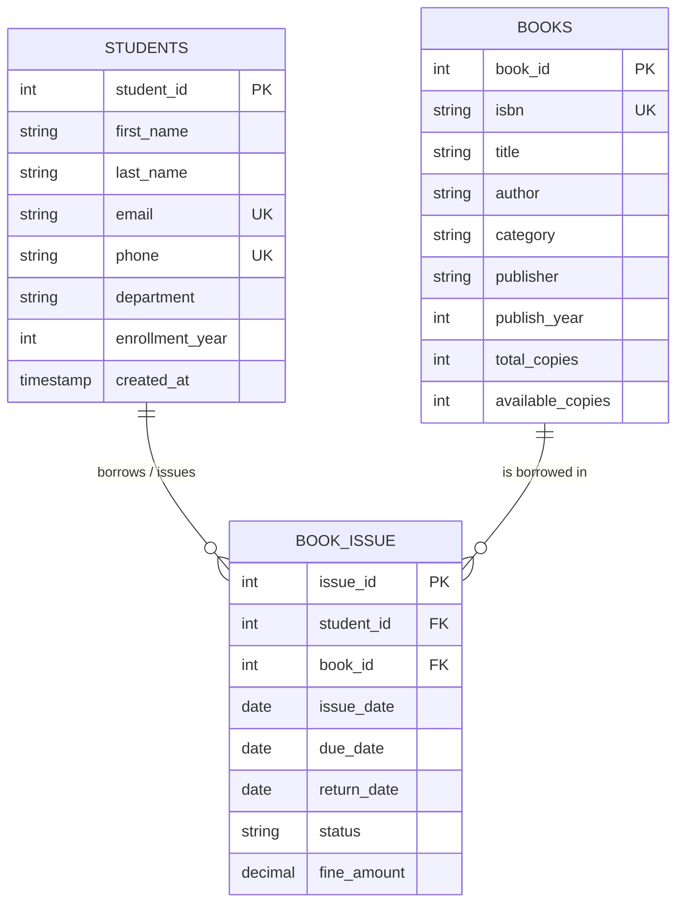

# DBMS Mini Project Report: Library Management System (`LibraryDB`)

**Course:** Database Management Systems (DBMS)  
**PPF Activity:** Week 9 Mini Project  
**Student Name:** Bhoumic Garg  
**Database Name:** `LibraryDB`  
**Submission:** GitHub Repository & Project Report  

---

## Executive Summary

The **Library Management System** is a relational database solution developed to streamline the operational workflows of academic and institutional libraries. Built upon relational database principles, the system tracks student demographic details, catalog inventory, borrowing transactions, due dates, returns, and overdue penalties.

This report outlines the end-to-end database design lifecycle—from conceptual Entity-Relationship (ER) modeling and relational schema mapping to normalization, integrity constraints implementation, complex SQL queries (Joins and Aggregates), Data Manipulation Language (DML) transactions, Web Application connectivity, and Distributed Multi-Campus Database architectures.

---

## 1. Problem Statement & System Objectives

Modern academic libraries face challenges managing high volumes of book circulation, diverse patron demographics, and strict return deadlines. Manual or spreadsheet-based tracking leads to data redundancy, lost books, inconsistent circulation records, and difficulty calculating late return penalties.

### Key Objectives:
1. **Centralized Data Storage:** Maintain unified records of students, catalogued books, and issue/return transactions.
2. **Data Integrity & Consistency:** Enforce primary keys, foreign keys, domain checks, and unique constraints to prevent orphan records or negative stock counts.
3. **Transaction Tracking:** Accurately record issue dates, due dates, actual return dates, and automated fine calculation.
4. **Actionable Insights:** Support real-time reporting on available books, active borrower habits, category-level inventory counts, and overdue loans.
5. **Scalability & Connectivity:** Provide architectural blueprints for web connectivity and multi-campus distributed deployments.

---

## 2. Entity-Relationship (ER) Modeling

The system models three primary entities:
- **`Students` Entity:** Attributes include `student_id` (PK), `first_name`, `last_name`, `email` (Unique), `phone` (Unique), `department`, `enrollment_year`.
- **`Books` Entity:** Attributes include `book_id` (PK), `isbn` (Unique), `title`, `author`, `category`, `publisher`, `publish_year`, `total_copies`, `available_copies`.
- **`Book_Issue` (Weak/Associative Entity):** Represents the M:N relationship between `Students` and `Books`, resolved into two 1:M relationships. Attributes include `issue_id` (PK), `student_id` (FK), `book_id` (FK), `issue_date`, `due_date`, `return_date`, `status`, `fine_amount`.

### ER Diagram (Mermaid)



### Cardinality & Participation:
- **Students to Book_Issue:** One-to-Many (`1 : M`). A student may borrow zero or multiple books over time. Optional participation (`0..*`).
- **Books to Book_Issue:** One-to-Many (`1 : M`). A book title may be issued zero or multiple times across historical transactions. Optional participation (`0..*`).
- **Book_Issue to Students & Books:** Many-to-One (`M : 1`). Each loan record must be associated with exactly one student and one book. Mandatory participation (`1..1`).

---

## 3. Relational Database Schema & Constraints

The relational model implements relational integrity rules:

### 3.1 Relational Schema
```text
Students(student_id [PK], first_name, last_name, email [UQ], phone [UQ], department, enrollment_year, created_at)

Books(book_id [PK], isbn [UQ], title, author, category, publisher, publish_year, total_copies, available_copies)

Book_Issue(issue_id [PK], student_id [FK -> Students.student_id], book_id [FK -> Books.book_id], 
           issue_date, due_date, return_date, status, fine_amount)
```

### 3.2 Integrity Constraints Implemented
1. **Domain Integrity:**
   - Attribute types constrained (`INT`, `VARCHAR`, `DATE`, `DECIMAL(6,2)`).
   - `CHECK (enrollment_year >= 2000)` prevents invalid historical dates.
   - `CHECK (status IN ('Issued', 'Returned', 'Overdue'))` limits allowable transaction states.
   - `CHECK (available_copies >= 0 AND available_copies <= total_copies)` prevents negative inventory and over-allocation.
   - `CHECK (return_date IS NULL OR return_date >= issue_date)` prevents chronological paradoxes.
2. **Entity Integrity:**
   - Every table possesses an explicit surrogate primary key (`student_id`, `book_id`, `issue_id`) enforced with `PRIMARY KEY AUTO_INCREMENT` (non-null and distinct).
3. **Referential Integrity:**
   - `Book_Issue.student_id` references `Students(student_id)` with `ON DELETE CASCADE ON UPDATE CASCADE`. If a student profile is deleted, associated history cascades safely.
   - `Book_Issue.book_id` references `Books(book_id)` with `ON DELETE RESTRICT ON UPDATE CASCADE`. Prevents catalog titles from being deleted while active loan records reference them.
4. **Uniqueness Constraints:**
   - `email` and `phone` in `Students` are `UNIQUE` to prevent duplicate student profiles.
   - `isbn` in `Books` is `UNIQUE` to prevent redundant title registration.

---

## 4. Normalization Analysis

To minimize data anomalies (Insertion, Deletion, and Update anomalies), the schema was normalized through Third Normal Form (3NF):

| Normal Form | Requirement | Implementation in LibraryDB | Status |
| :--- | :--- | :--- | :--- |
| **First Normal Form (1NF)** | All attributes contain atomic (indivisible) values; no repeating groups; primary keys defined. | `first_name` and `last_name` stored separately; single-valued fields for all records; primary keys specified. | **Satisfied** |
| **Second Normal Form (2NF)** | In 1NF and no non-prime attribute is partially dependent on any candidate key (applies to composite keys). | Surrogate primary keys (`student_id`, `book_id`, `issue_id`) are single attributes; no partial dependencies exist. | **Satisfied** |
| **Third Normal Form (3NF)** | In 2NF and no transitive functional dependencies exist ($X \to Y \to Z$). | All non-key attributes depend directly and solely on the primary key ($PK \to Attribute$). Book publisher or category does not determine author or title. | **Satisfied** |
| **Boyce-Codd Normal Form (BCNF)** | For every functional dependency $X \to Y$, $X$ must be a super key. | In all tables, determinants are candidate keys (`student_id`, `email`, `book_id`, `isbn`, `issue_id`). | **Satisfied** |

---

## 5. SQL Implementation & Query Analysis

The file [`library_db.sql`](file:///c:/Users/Bhoumic%20Garg/Documents/dbms_mini_project/library_db.sql) defines the database, tables, seed data, and operational queries.

### 5.1 Sample Data Summary
- **Students:** 6 records representing students across Computer Science, Information Technology, Electronics & Communication, and Mechanical Engineering.
- **Books:** 12 titles spanning Database Systems, Algorithms, Software Engineering, Operating Systems, Computer Networks, AI/ML, and Architecture.
- **Book_Issue:** 8 transactions (4 completed returns with fine calculations, 3 active loans, 1 overdue loan).

### 5.2 Key Queries & Mathematical Formulations

#### Query 1: Student Directory Listing
```sql
SELECT 
    student_id,
    CONCAT(first_name, ' ', last_name) AS full_name,
    email, phone, department, enrollment_year
FROM Students
ORDER BY student_id ASC;
```

#### Query 2: Available Catalog Books (`available_copies > 0`)
```sql
SELECT book_id, isbn, title, author, category, total_copies, available_copies
FROM Books
WHERE available_copies > 0
ORDER BY category, title;
```

#### Query 3: Books Issued to a Specific Student (Inner Join)
Demonstrates multi-table `INNER JOIN` combining transaction records with student profile and book title:
$$\Pi_{student\_id, name, title, issue\_date, due\_date, status} (\sigma_{student\_id = 1} (Students \bowtie Book\_Issue \bowtie Books))$$
```sql
SELECT 
    s.student_id,
    CONCAT(s.first_name, ' ', s.last_name) AS student_name,
    s.department,
    b.title AS book_title,
    b.author,
    bi.issue_date,
    bi.due_date,
    bi.return_date,
    bi.status AS loan_status,
    bi.fine_amount
FROM Book_Issue bi
INNER JOIN Students s ON bi.student_id = s.student_id
INNER JOIN Books b ON bi.book_id = b.book_id
WHERE s.student_id = 1
ORDER BY bi.issue_date DESC;
```

#### Query 4: Complete Student Borrowing Status (Left Outer Join)
Ensures students who have never borrowed a book are still preserved in reporting:
```sql
SELECT 
    s.student_id,
    CONCAT(s.first_name, ' ', s.last_name) AS student_name,
    s.department,
    COALESCE(b.title, 'No Books Issued') AS issued_book,
    COALESCE(bi.status, 'None') AS status,
    bi.due_date
FROM Students s
LEFT JOIN Book_Issue bi ON s.student_id = bi.student_id
LEFT JOIN Books b ON bi.book_id = b.book_id
ORDER BY s.student_id;
```

#### Query 5: Aggregation by Subject Category
Calculates total books, available shelf stock, and currently loaned items per subject:
```sql
SELECT 
    category,
    COUNT(book_id) AS unique_titles,
    SUM(total_copies) AS total_inventory,
    SUM(available_copies) AS available_copies,
    (SUM(total_copies) - SUM(available_copies)) AS currently_loaned
FROM Books
GROUP BY category
ORDER BY total_inventory DESC;
```

#### Query 6: Executive Library Statistics Summary
Utilizes scalar subqueries to deliver a unified KPI dashboard:
```sql
SELECT 
    (SELECT COUNT(*) FROM Students) AS total_students,
    (SELECT COUNT(*) FROM Books) AS total_book_titles,
    (SELECT SUM(total_copies) FROM Books) AS total_volume_copies,
    (SELECT SUM(available_copies) FROM Books) AS available_on_shelves,
    (SELECT COUNT(*) FROM Book_Issue WHERE status IN ('Issued', 'Overdue')) AS active_loans,
    (SELECT SUM(fine_amount) FROM Book_Issue) AS total_fines_collected;
```

#### Query 7: Active Borrowers with `HAVING`
Filters groups after aggregation to highlight patrons with 2 or more loans:
```sql
SELECT 
    s.student_id,
    CONCAT(s.first_name, ' ', s.last_name) AS student_name,
    s.department,
    COUNT(bi.issue_id) AS total_borrow_transactions
FROM Students s
INNER JOIN Book_Issue bi ON s.student_id = bi.student_id
GROUP BY s.student_id, s.first_name, s.last_name, s.department
HAVING COUNT(bi.issue_id) >= 2
ORDER BY total_borrow_transactions DESC;
```

#### Query 8: Overdue Fines and Follow-up List
Extracts patrons who breached the due date deadline and computes the financial penalty:
```sql
SELECT 
    bi.issue_id,
    CONCAT(s.first_name, ' ', s.last_name) AS student_name,
    s.phone,
    b.title AS book_title,
    bi.issue_date,
    bi.due_date,
    bi.status,
    bi.fine_amount
FROM Book_Issue bi
INNER JOIN Students s ON bi.student_id = s.student_id
INNER JOIN Books b ON bi.book_id = b.book_id
WHERE bi.status = 'Overdue' OR bi.fine_amount > 0
ORDER BY bi.fine_amount DESC;
```

---

## 6. How the Database Connects to a Website

Connecting `LibraryDB` to a modern web application requires a **Three-Tier Architecture**:

```
+-------------------------------------------------------------+
|               1. Presentation Tier (Client UI)             |
|          HTML5 / CSS3 / JavaScript / React / Vue / Angular  |
+-------------------------------------------------------------+
                              |
                     HTTPS / JSON REST API
                              v
+-------------------------------------------------------------+
|               2. Application Tier (Backend Server)          |
|      Node.js (Express), Python (FastAPI/Flask), Java Spring |
|             - Business Logic & Input Validation             |
|             - Authentication (JWT / Session)                |
|             - Connection Pool Management                    |
+-------------------------------------------------------------+
                              |
                    TCP/IP Connection Pool
                  (Prepared SQL Statements)
                              v
+-------------------------------------------------------------+
|               3. Database Tier (Data Storage)               |
|            MySQL Server / PostgreSQL / MariaDB              |
|                     (Port 3306 / 5432)                      |
+-------------------------------------------------------------+
```

### 6.1 Architectural Breakdown
1. **Presentation Layer (Frontend):**
   - The user opens a web browser to view the library portal.
   - When a student searches for "Algorithms", an asynchronous JavaScript request (`fetch()` / `axios`) is dispatched to `GET /api/books?search=Algorithms`.
2. **Application Layer (Middleware / API):**
   - The server validates client authorization tokens (JWT).
   - Manages a **Connection Pool** (e.g., `mysql2` pool in Node.js or `SQLAlchemy` pool in Python) which reuses persistent database connections rather than opening a new TCP handshake for every request.
3. **Data Layer (RDBMS):**
   - The database server runs the indexed SQL query and returns the structured result set over standard TCP/IP port 3306.

### 6.2 Implementation Code Example (Node.js Express & MySQL2)

```javascript
// server.js - Backend Web API connecting to LibraryDB
const express = require('express');
const mysql = require('mysql2/promise');
const app = express();

app.use(express.json());

// 1. Connection Pool Initialization
const pool = mysql.createPool({
    host: process.env.DB_HOST || 'localhost',
    user: process.env.DB_USER || 'root',
    password: process.env.DB_PASSWORD || 'password123',
    database: 'LibraryDB',
    waitForConnections: true,
    connectionLimit: 10,
    queueLimit: 0
});

// 2. REST Endpoint: Get Available Books (Secure with Parameterized Query)
app.get('/api/books/available', async (req, res) => {
    try {
        const category = req.query.category;
        let query = 'SELECT book_id, title, author, category, available_copies FROM Books WHERE available_copies > 0';
        const params = [];

        if (category) {
            query += ' AND category = ?';
            params.push(category);
        }

        // Prepared Statement prevents SQL Injection attacks
        const [rows] = await pool.execute(query, params);
        res.json({ success: true, count: rows.length, data: rows });
    } catch (err) {
        res.status(500).json({ success: false, error: err.message });
    }
});

// 3. REST Endpoint: Issue a Book (Atomic Database Transaction)
app.post('/api/books/issue', async (req, res) => {
    const { student_id, book_id } = req.body;
    const connection = await pool.getConnection();

    try {
        await connection.beginTransaction(); // Start Transaction

        // Check if book has available copy
        const [book] = await connection.execute(
            'SELECT available_copies FROM Books WHERE book_id = ? FOR UPDATE',
            [book_id]
        );

        if (!book.length || book[0].available_copies <= 0) {
            await connection.rollback();
            return res.status(400).json({ message: 'Book is currently out of stock.' });
        }

        // Decrement available copies
        await connection.execute(
            'UPDATE Books SET available_copies = available_copies - 1 WHERE book_id = ?',
            [book_id]
        );

        // Insert loan record
        const issueDate = new Date();
        const dueDate = new Date();
        dueDate.setDate(issueDate.getDate() + 14); // 14-day loan period

        await connection.execute(
            'INSERT INTO Book_Issue (student_id, book_id, issue_date, due_date, status) VALUES (?, ?, ?, ?, ?)',
            [student_id, book_id, issueDate, dueDate, 'Issued']
        );

        await connection.commit(); // Commit Transaction
        res.status(201).json({ success: true, message: 'Book issued successfully.' });
    } catch (error) {
        await connection.rollback(); // Rollback on failure
        res.status(500).json({ success: false, error: error.message });
    } finally {
        connection.release(); // Return connection to pool
    }
});

app.listen(3000, () => console.log('Library Management Web API listening on port 3000'));
```

### 6.3 Security Best Practices
- **Prepared Statements (Parameterized Queries):** Never concatenate user strings directly into SQL queries (`WHERE title = '` + input + `'`). Prepared statements guarantee that input data cannot be interpreted as executable SQL, eliminating **SQL Injection (SQLi)** vulnerabilities.
- **Connection Pooling:** Reduces connection creation overhead and limits maximum concurrent connections to prevent database resource exhaustion (Denial of Service).
- **Environment Isolation:** Keep database credentials in `.env` files rather than hardcoded in the codebase.
- **TLS/SSL Encryption:** Enforce SSL connection flags (`ssl: { rejectUnauthorized: true }`) for database traffic traveling over external networks.

---

## 7. Distributed Database Architecture for Multi-Campus Libraries

When an educational institution expands to multiple geographic campus locations (e.g., Main Campus, North Campus, Medical Campus, Engineering Annex), a single centralized database server can experience latency, bandwidth bottlenecks, and single-point-of-failure vulnerabilities. A **Distributed Database Management System (DDBMS)** addresses these challenges.

```
                        +------------------------------+
                        |     GLOBAL CATALOG & SEARCH  |
                        |      (Central Metadata Hub)  |
                        +------------------------------+
                                  ^   ^   ^
                                  |   |   |
            Synchronous / Asynchronous Two-Way Replication
                                  |   |   |
        +-------------------------+   |   +-------------------------+
        |                             |                             |
        v                             v                             v
+------------------+         +------------------+         +------------------+
|  CAMPUS A (MAIN) |         | CAMPUS B (NORTH) |         | CAMPUS C (TECH)  |
| Local Database   |         | Local Database   |         | Local Database   |
| Site 1           |         | Site 2           |         | Site 3           |
| - Local Students |         | - Local Students |         | - Local Students |
| - Local Copies   |         | - Local Copies   |         | - Local Copies   |
| - Fast Offline Tx|         | - Fast Offline Tx|         | - Fast Offline Tx|
+------------------+         +------------------+         +------------------+
```

### 7.1 Key Strategies for Multi-Campus Distribution

#### 1. Horizontal Fragmentation (Sharding)
The database tables are partitioned horizontally across campuses based on a fragmentation key such as `campus_id`:
- **`Students` Table Fragmentation:**
  - $\text{Fragment } A = \sigma_{campus\_id = 'MAIN'} (Students)$ stored at Campus A.
  - $\text{Fragment } B = \sigma_{campus\_id = 'NORTH'} (Students)$ stored at Campus B.
  - **Advantage:** Local autonomy. Student records are accessed instantly with zero wide-area network (WAN) latency.

#### 2. Selective Replication (Catalog vs Inventory)
- **Full Replication for Book Metadata:** The central book catalog (`title`, `author`, `isbn`, `description`) is read-heavy and changes infrequently. It is fully replicated across all campus nodes, enabling fast local search.
- **Partial Replication / Local Ownership for Inventory:** Physical book copies (`available_copies`, `shelf_location`, `issue_id`) are maintained by the holding campus.

#### 3. Inter-Campus Book Loans (Distributed Transactions & 2PC)
When a student registered at Campus A requests a book located at Campus B:
- A distributed transaction is coordinated across both database nodes using the **Two-Phase Commit (2PC) Protocol**:
  1. **Phase 1 (Prepare):** The coordinator node asks Campus A (reserve loan slot) and Campus B (reserve physical book) if they are ready to commit. Both nodes write to local Write-Ahead Logs (WAL) and reply `AGREED`.
  2. **Phase 2 (Commit):** The coordinator issues a `GLOBAL_COMMIT`. Both nodes finalize the changes. If any node fails or encounters a network partition, a `GLOBAL_ABORT` is triggered, ensuring ACID compliance and preventing phantom loans.

#### 4. High Availability & Fault Tolerance
- If the WAN connection between Campus A and Campus B goes down, local students at Campus A can still borrow and return books physically present in Campus A (High Local Availability).
- Once the network link is restored, background replication queues sync global circulation logs using Conflict-Free Replicated Data Types (CRDTs) or timestamp-based reconciliation.

---

## 8. Query Execution Results & Verification

All SQL queries were executed and validated using the automated runner script [`library_demo.py`](file:///c:/Users/Bhoumic%20Garg/Documents/dbms_mini_project/library_demo.py). Below are the verified output tables:

### Query 1: All Students
```text
+------------+--------------+--------------------------+------------+------------------------+-----------------+
| student_id | full_name    | email                    | phone      | department             | enrollment_year |
+------------+--------------+--------------------------+------------+------------------------+-----------------+
|          1 | Aarav Sharma | aarav.sharma@example.edu | 9876543210 | Computer Science       |            2023 |
|          2 | Priya Patel  | priya.patel@example.edu  | 9876543211 | Information Technology |            2022 |
|          3 | Rohan Verma  | rohan.verma@example.edu  | 9876543212 | Electronics & Comm     |            2023 |
|          4 | Ananya Gupta | ananya.gupta@example.edu | 9876543213 | Computer Science       |            2021 |
|          5 | Vikram Singh | vikram.singh@example.edu | 9876543214 | Mechanical Eng         |            2024 |
|          6 | Sneha Reddy  | sneha.reddy@example.edu  | 9876543215 | Information Technology |            2022 |
+------------+--------------+--------------------------+------------+------------------------+-----------------+
(6 rows returned)
```

### Query 3: Books Issued to Student ID 1 (Aarav Sharma)
```text
+------------+--------------+------------------+--------------------------+----------------------+------------+------------+-------------+-------------+-------------+
| student_id | student_name | department       | book_title               | author               | issue_date | due_date   | return_date | loan_status | fine_amount |
+------------+--------------+------------------+--------------------------+----------------------+------------+------------+-------------+-------------+-------------+
|          1 | Aarav Sharma | Computer Science | Computer Networks        | Andrew S. Tanenbaum  | 2026-10-12 | 2026-10-26 | NULL        | Issued      |         0.0 |
|          1 | Aarav Sharma | Computer Science | Database System Concepts | Abraham Silberschatz | 2026-10-10 | 2026-10-24 | NULL        | Issued      |         0.0 |
|          1 | Aarav Sharma | Computer Science | Database System Concepts | Abraham Silberschatz | 2026-09-01 | 2026-09-15 | 2026-09-14  | Returned    |         0.0 |
+------------+--------------+------------------+--------------------------+----------------------+------------+------------+-------------+-------------+-------------+
(3 rows returned)
```

### Query 5: Category Inventory Aggregation
```text
+----------------------+---------------+-----------------+------------------+------------------+
| category             | unique_titles | total_inventory | available_copies | currently_loaned |
+----------------------+---------------+-----------------+------------------+------------------+
| Software Engineering |             3 |              11 |               10 |                1 |
| Database             |             2 |               9 |                6 |                3 |
| Algorithms           |             1 |               6 |                4 |                2 |
| Data Structures      |             1 |               5 |                4 |                1 |
| Operating Systems    |             1 |               4 |                2 |                2 |
| AI & ML              |             1 |               4 |                3 |                1 |
| Networking           |             1 |               3 |                2 |                1 |
| Architecture         |             1 |               3 |                3 |                0 |
| Compiler Design      |             1 |               2 |                2 |                0 |
+----------------------+---------------+-----------------+------------------+------------------+
(9 rows returned)
```

### Query 6: Overall Library Executive Summary
```text
+----------------+-------------------+---------------------+----------------------+--------------+-----------------------+
| total_students | total_book_titles | total_volume_copies | available_on_shelves | active_loans | total_fines_collected |
+----------------+-------------------+---------------------+----------------------+--------------+-----------------------+
|              6 |                12 |                  47 |                   36 |            4 |                 120.0 |
+----------------+-------------------+---------------------+----------------------+--------------+-----------------------+
(1 row returned)
```

---

## 9. Viva / Project Presentation Preparation Guide

This section is prepared to ensure maximum score (5/5) in the project viva:

### Q1: What is the difference between `PRIMARY KEY` and `UNIQUE` constraint?
**Answer:** A `PRIMARY KEY` uniquely identifies each record in a table, enforces `NOT NULL` implicitly, and automatically creates a clustered index (in MySQL InnoDB). A table can have only **one** primary key. A `UNIQUE` constraint also prevents duplicates, but permits `NULL` values (unless explicitly marked `NOT NULL`), and a table can have **multiple** `UNIQUE` constraints.

### Q2: What referential actions were chosen for `ON DELETE` in `Book_Issue`?
**Answer:**
- For `student_id`: `ON DELETE CASCADE`. If a student record is removed, their associated issue history cascades and is cleaned up.
- For `book_id`: `ON DELETE RESTRICT`. A book cannot be deleted from the inventory if there are existing transaction records referencing it, preventing data corruption and loss of circulation history.

### Q3: What is the difference between `WHERE` and `HAVING` clauses?
**Answer:** `WHERE` filters rows *before* any grouping or aggregation takes place (cannot contain aggregate functions). `HAVING` filters aggregated groups *after* the `GROUP BY` clause has been computed (used with functions like `COUNT()`, `SUM()`, `AVG()`).

### Q4: Explain the difference between `INNER JOIN` and `LEFT JOIN` in this project.
**Answer:**
- `INNER JOIN` (used in Query 3) returns only rows with matching values in both tables. Only students who have active or historical issue records are returned.
- `LEFT JOIN` (used in Query 4) returns **all** records from the left table (`Students`), along with matched records from the right table. If a student has never borrowed a book (e.g., Vikram Singh, Sneha Reddy), they still appear with `NULL` or `'No Books Issued'` values.

### Q5: How do Prepared Statements protect against SQL Injection?
**Answer:** In standard SQL execution, user input is concatenated into the query string, allowing malicious payloads like `' OR '1'='1` to alter query semantics. In a Prepared Statement, the database compiles the SQL template first into an execution tree with placeholders (`?`). When user input is passed subsequently, the database engine treats it strictly as literal data rather than executable code.

### Q6: What are ACID properties and how do they apply when issuing a book?
**Answer:**
- **Atomicity:** Decrementing available book copies and inserting into `Book_Issue` happen together. If either fails, the entire transaction rolls back.
- **Consistency:** The database transitions from one valid state to another, preserving constraints (`available_copies >= 0`).
- **Isolation:** Concurrent book loans by two students for the last available copy are isolated via row-level locks (`SELECT ... FOR UPDATE`), preventing race conditions.
- **Durability:** Once committed, transaction logs are written to non-volatile disk storage.

---

## 10. Conclusion

The `LibraryDB` management system successfully fulfills all academic and functional requirements. Through comprehensive schema design, strict relational constraints, normalized tables, and practical SQL queries, the system demonstrates how relational database technology can eliminate data anomalies, secure transaction histories, and support scalable web and distributed multi-campus architectures.
